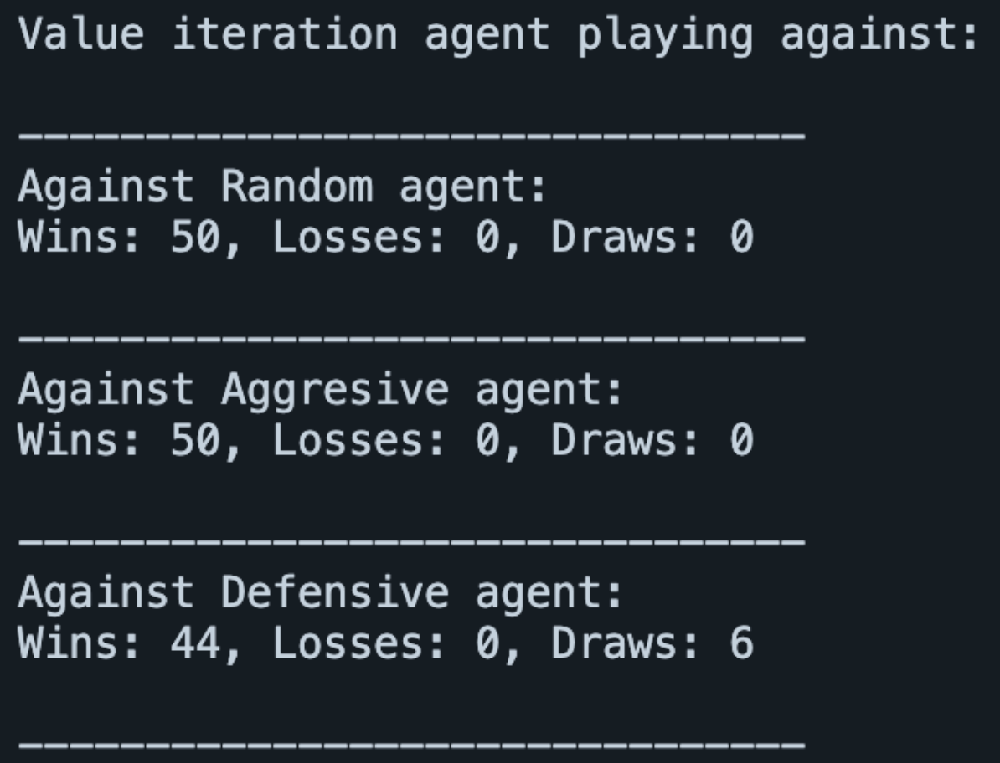
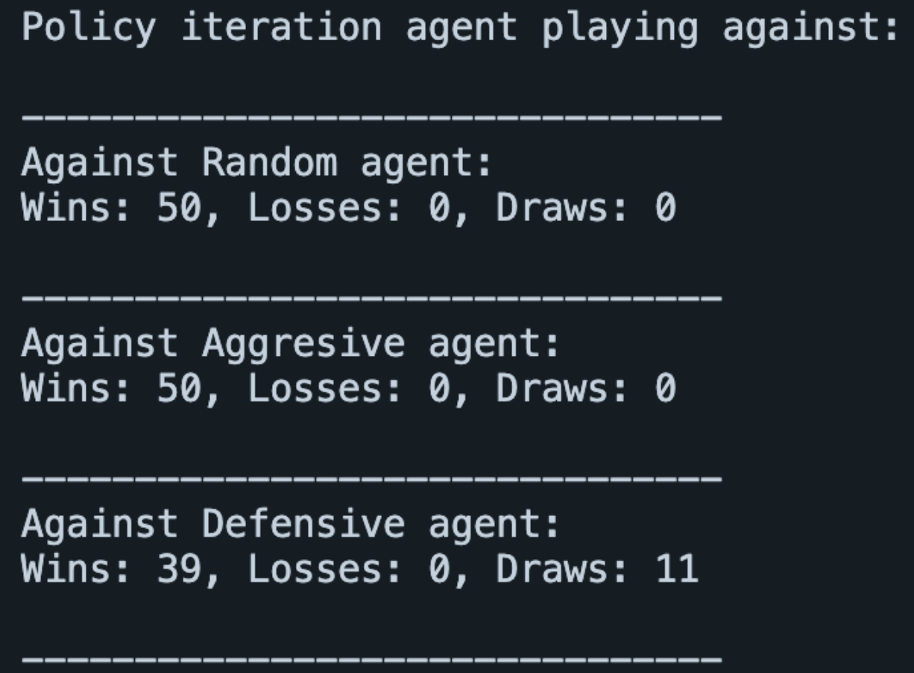
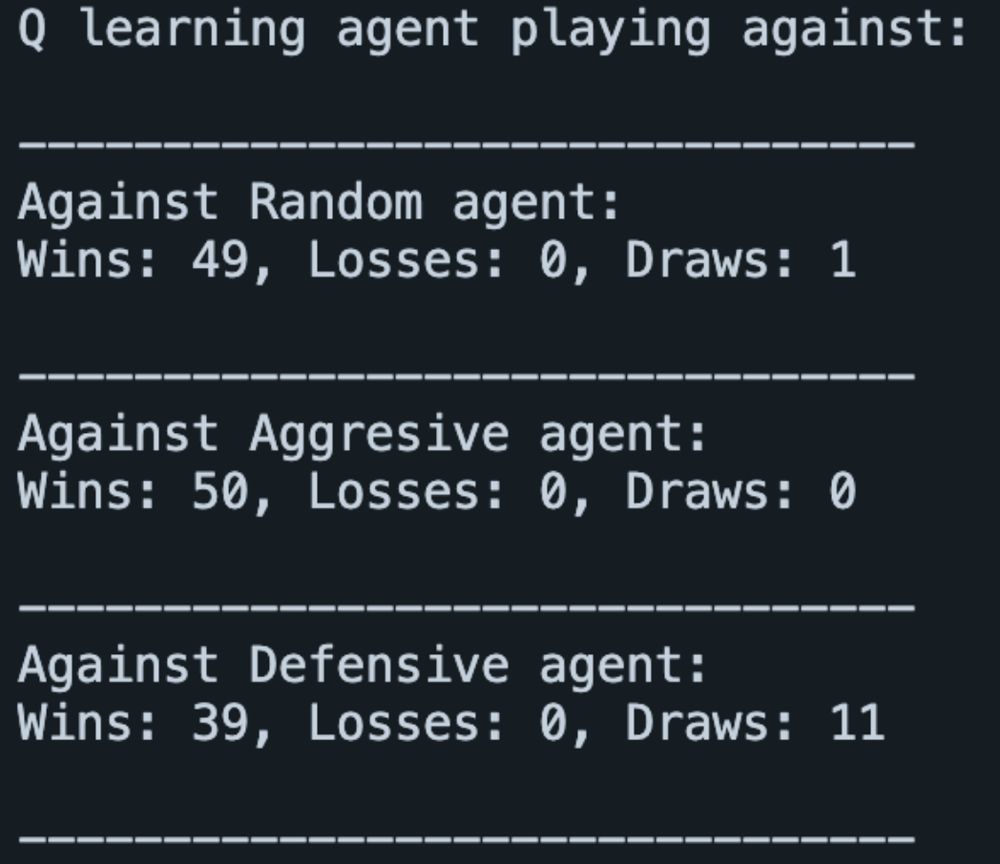

# Tic-Tac-Toe MDP Agents

Value Iteration, Policy Iteration and Q-Learning agents for Tic-Tac-Toe, modelled as a Markov Decision Process (MDP) and written in Java. Each agent was tested against random, aggressive and defensive opponents.

This was coursework for an Artificial Intelligence course at Heriot-Watt University (Dec 2024). The course provided the game framework and the agent skeletons. My work was implementing the methods listed below.

> **Note:** The course framework (the game environment, MDP, `Agent`, `QTable`, etc.) is not included in this repo, so these files will not compile on their own.

## Agents

| Agent | Type | What I implemented | Key parameters |
|---|---|---|---|
| `ValueIterationAgent` | Model-based (dynamic programming) | `iterate()`: Bellman updates over all states for *k* iterations. `extractPolicy()`: chooses the action with the highest Q-value in each state | γ = 0.9, k = 10 |
| `PolicyIterationAgent` | Model-based (dynamic programming) | `initRandomPolicy()`, `evaluatePolicy()` (runs until the value change is below δ), `improvePolicy()`, `train()` (repeats evaluation and improvement until the policy stops changing) | γ = 0.9, δ = 0.1 |
| `QLearningAgent` | Model-free (reinforcement learning) | `train()`: ε-greedy exploration with Q-value updates `Q ← (1−α)Q + α(r + γ·max Q(s′,a′))`. `extractPolicy()`: greedy policy from the Q-table | α = 0.3, γ = 0.9, ε = 0.6, 50,000 episodes |

## Results

Each agent played 50 games against each opponent type.

| Value Iteration | Policy Iteration | Q-Learning |
|---|---|---|
|  |  |  |

Full write-ups are in [`docs/`](docs).

## Structure

```
src/ticTacToe/     Agent implementations
docs/              Reports (PDF)
docs/images/       Result figures
```